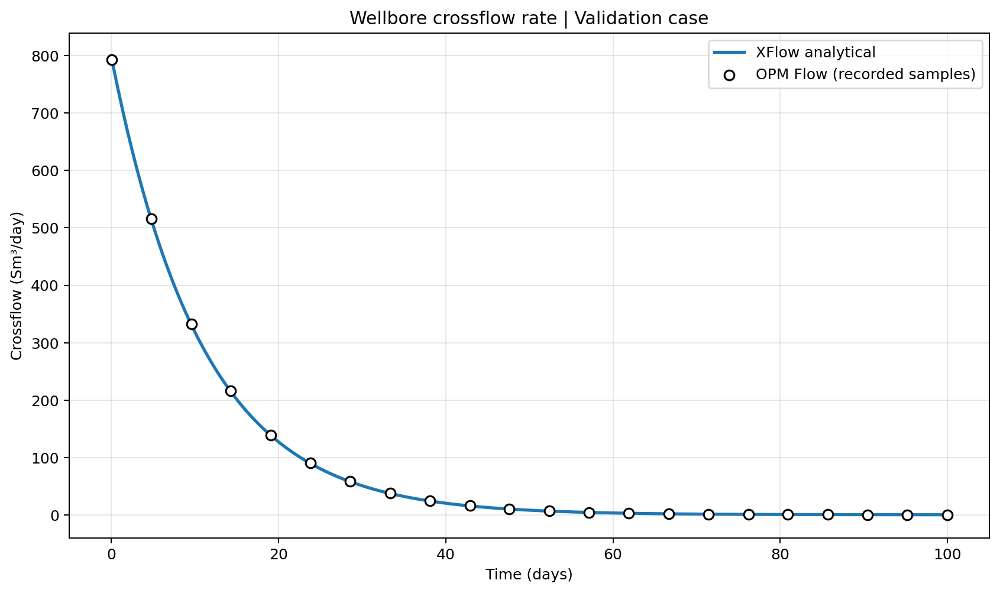
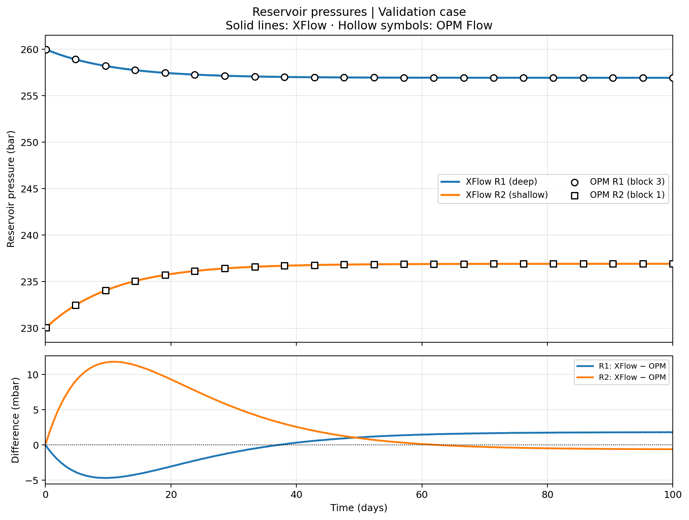
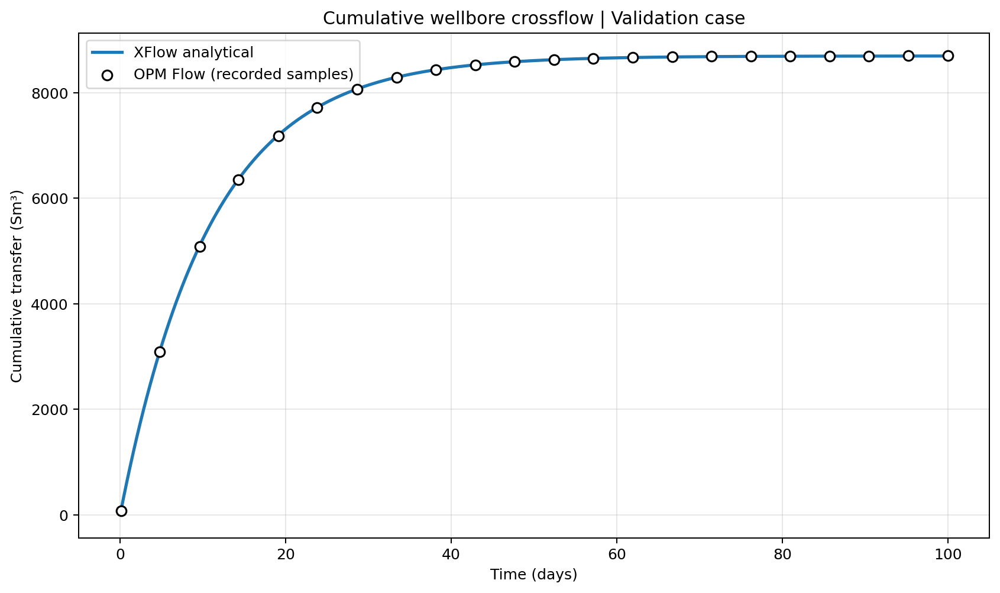

# XFlow

XFlow calculates shut-in wellbore crossflow between two isolated reservoirs using a **closed-form analytical two-tank model**. Open downhole completions connect the reservoirs, while surface well flow is zero.

## Run

With no arguments, XFlow loads `cases/validation_case.json`, calculates crossflow, displays three plots, and includes the recorded OPM Flow benchmark automatically.

## Run your own case

1. Copy `cases/validation_case.json` to `cases/my_case.json`.
2. Edit the numeric parameters in your copy (pressures, reservoir properties, completion depths, etc.). The JSON must include all parameters; units are given below.
3. Run

OPM Flow benchmark overlays appear **only** when running the bundled `cases/validation_case.json`. A copied or custom JSON file generates analytical results only, even when its parameters are identical to the validation inputs. 

Run without opening plot windows:
run_python_case.py --no-show
run_python_case.py cases\my_case.json --no-show

Additional options are `--days 100`, `--points 500`, and `--output-dir PATH`. Run `--help` for details.

## Case JSON format

The complete input template is [`cases/validation_case.json`](cases/validation_case.json). All keys are required to avoid silently using assumed values.

| Parameter group | Keys | Units |
|---|---|---|
| Reservoir geometry | `phi1`, `phi2`, `h1_m`, `h2_m`, `re_m`, `rw_m`, `depth1_m`, `depth2_m` | Porosities fractional; lengths metres |
| Reservoir hydraulic properties | `k1_md`, `k2_md`, `skin1`, `skin2`, `mu1_cp`, `mu2_cp`, `bw1`, `bw2` | Permeability mD; viscosity cP; B in reservoir m³/Sm³; skin dimensionless |
| Pressure/storage | `p1_start_bar`, `p2_start_bar`, `cw1_bar`, `cw2_bar`, `cf1_bar`, `cf2_bar` | Pressures bar; compressibilities 1/bar |
| Shared head | `pressure_gradient_bar_m` | bar/m |
| Reporting cutoff | `pressure_tolerance_bar` | bar; does not control numerical accuracy |

R1 and R2 are arbitrary reservoir identifiers; either may be deeper or initially at higher pressure. **Signed crossflow** is positive from R1 to R2 and negative from R2 to R1, determined by the pressure difference corrected for hydrostatic head. The same closed-form solution accommodates either direction and an initial-equilibrium case (zero flow). The analytical formulation assumes **constant fluid and rock properties, constant reservoir storage coefficients, and constant productivity indices**; the wellbore flow resistance is treated as symmetric.

The `crossflow_std_m3d` and `cumulative_crossflow_std_m3` output columns are **signed**. `flow_direction` in the analytical summary is `R1_to_R2`, `R2_to_R1`, or `equilibrium`. The bundled OPM comparison applies only to the original validation case; custom cases never use its OPM overlay.

## Outputs

The validation case is written to `outputs/validation/`. A modified file such as `cases/my_case.json` is written to `outputs/my_case/`, or to the directory supplied through `--output-dir`.

Every run writes:

- `inputs.json` — resolved numerical inputs
- `analytical_summary.json` — initial rate, time constant, equilibrium pressures and transfer
- `analytical_timeseries.csv` — time, rate, reservoir and wellbore pressures, cumulative volume
- `crossflow_rate_vs_time.png`, `reservoir_pressures_vs_time.png`, `cumulative_crossflow_vs_time.png`

The bundled validation case additionally writes `opm_analytical_time_aligned.csv` and `opm_comparison_metrics.csv`. 

## OPM Flow benchmark

Recorded data in [`validation/opm_flow_timeseries.csv`](validation/opm_flow_timeseries.csv) were extracted from `CASE.SMSPEC` and `CASE.UNSMRY`: 1,000 records at days 0.1–100. The first OPM rate is **not** a time-zero rate. Results are aligned at the actual OPM timestamps before comparisons. The application does **not** run OPM Flow itself. The original OPM Flow deck is `simulation_deck/CASE.DATA`.

The OPM time series is bundled for reference and is not required for running custom cases.

Further provenance and validation metrics: [`validation/README.md`](validation/README.md).

## Validation figures

